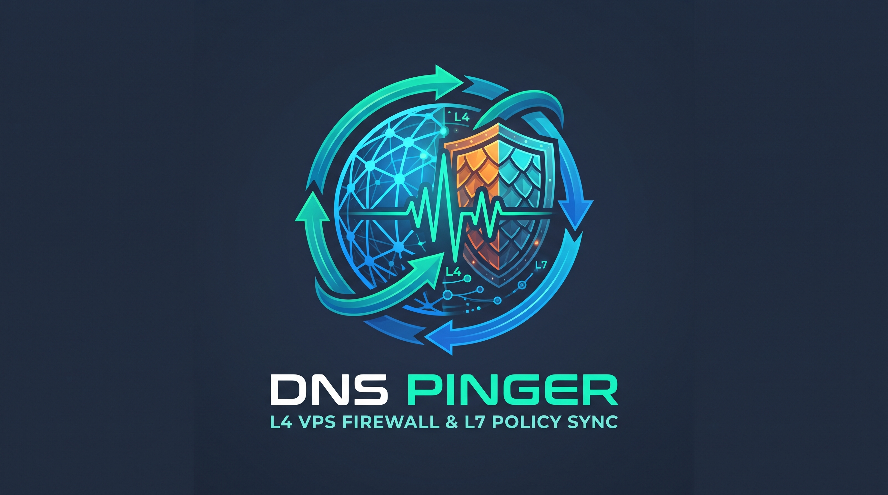

# DNS Pinger

A lightweight daemon that continuously monitors dynamic DNS records and synchronizes them with your **Hostinger VPS Firewall** (Layer 4) and/or **Pangolin Shared Policies** (Layer 7).

If your home or office IP changes frequently, DNS Pinger resolves your domains and updates your Hostinger VPS firewall group and Pangolin resource policies automatically so you never get locked out.

---

## Features

* **Dual-Layer Synchronization**: Manage Hostinger VPS firewall rules (Infrastructure as Code), Pangolin Shared Policies (Public Resource Policies), or both simultaneously.
* **Dynamic DNS Tracking**: Resolves domain records (`A` and `AAAA`) at configurable intervals.
* **On-the-Fly Config Reloading**: Edit your rules in `config/hostinger-config.yaml` and `config/pangolin-config.yaml` anytime; the container re-evaluates the config files dynamically on each check without requiring a container restart or recreation.
* **Drift & Change Detection**: Compares desired rules against active rules in Hostinger and Pangolin, only making API calls when DNS records or configuration rules actually change.
* **DNS Outage Safeguard**: If DNS resolution temporarily fails or returns no records, the update cycle is aborted to prevent wiping out active rules.
* **Graceful Shutdown**: Listens for `SIGTERM` and `SIGINT` signals to terminate immediately and cleanly.
* **Structured Logging**: Formatted timestamps and log levels (`INFO`, `DEBUG`, `WARNING`, `ERROR`).

---

## Quickstart

### 1. Configure Environment

Copy the example environment file and fill in your values:

```bash
cp .env.example .env
```

Edit `.env` with your details:
* **General**:
  * `DOMAINS`: Comma-separated list of domains to track (e.g. `home.example.com`).
* **Hostinger VPS Firewall** *(optional if only using Pangolin)*:
  * `HOSTINGER_API_KEY` (or `APIKEY`): Your Hostinger API token (with VPS management permissions).
  * `FIREWALL_NAME`: The name of the firewall group in Hostinger (e.g. `MyFirewallGroup`).
* **Pangolin Shared Policy** *(optional if only using Hostinger)*:
  * `PANGOLIN_URL`: Base URL for your Pangolin Integration API (e.g. `https://api.example.com`).
  * `PANGOLIN_API_KEY`: Your Pangolin Integration API key (with `Get Resource Policy` and `Set Resource Policy Rules` permissions).
  * `PANGOLIN_POLICY_ID`: Numeric ID of the Shared Policy to update (or set `PANGOLIN_ORG_ID` and `PANGOLIN_POLICY_NAME` with `List Resource Policies` permission).

### 2. Configure Rules

Copy the example configuration files for the integrations you are using:

```bash
cp config/hostinger-config.yaml.example config/hostinger-config.yaml
cp config/pangolin-config.yaml.example config/pangolin-config.yaml
```

#### Hostinger Firewall Rules (`config/hostinger-config.yaml`)
Use `source_detail: "{{ dns_record }}"` on rules where you want your resolved dynamic IP addresses inserted:

```yaml
---
name: Example
rules:
  - action: accept
    protocol: SSH
    port: "22"
    source: custom
    source_detail: "{{ dns_record }}"
  - action: accept
    protocol: HTTP
    port: "80"
    source: any
    source_detail: any
  - action: accept
    protocol: HTTPS
    port: "443"
    source: any
    source_detail: any
  - action: accept
    protocol: UDP
    port: "443"
    source: any
    source_detail: any
```

#### Pangolin Shared Policy Rules & Authentication (`config/pangolin-config.yaml`)
Use `value: "{{ dns_record }}"` on rules where you want your resolved dynamic IP addresses inserted. You can also optionally define an `auth:` block to manage Pangolin Shared Policy authentication settings (SSO, Roles, Users, Identity Provider, Email Whitelist, Password, PIN Code, Header Auth, and mTLS). String values in YAML support `${ENV_VAR}` and `${ENV_VAR:-default}` environment variable interpolation:

```yaml
---
name: Example Shared Policy
apply_rules: true

# Optional: Only the auth sub-sections explicitly uncommented/defined are synced
# auth:
#   sso:
#     enabled: true
#     roles: ["Member"]
#     users: []
#     idp: null
#   email_whitelist:
#     enabled: false
#     emails: ["user@example.com", "*@example.com"]
#   password:
#     enabled: false
#     value: "${PANGOLIN_POLICY_PASSWORD}"
#   pincode:
#     enabled: false
#     value: "123456"
#   header_auth:
#     enabled: false
#     user: "myuser"
#     password: "${PANGOLIN_HEADER_AUTH_PASSWORD}"
#     extended_compatibility: false
#   mtls_enabled: false

rules:
  - action: ACCEPT
    match: IP
    value: "{{ dns_record }}"
    priority: 100
    enabled: true
  - action: DROP
    match: CIDR
    value: "0.0.0.0/0"
    priority: 200
    enabled: true
```

### 3. Run with Docker Compose

Start the container in the background:

```bash
docker compose up -d
```

Check the logs:

```bash
docker compose logs -f
```

---

## Configuration Reference

All settings can be configured via environment variables in `.env` or `docker-compose.yaml`:

### General Settings

| Variable | Required | Default | Description |
| :--- | :---: | :--- | :--- |
| `DOMAINS` | **Yes** | — | Comma-separated domains to monitor (e.g. `home.example.com,vpn.example.com`). |
| `RECORD_TYPES` | No | `A` | DNS record types to resolve (`A`, `AAAA`, or `A,AAAA`). |
| `INTERVAL` | No | `300` | Seconds to wait between DNS and rule checks. |
| `LOG_LEVEL` | No | `INFO` | Logging level (`DEBUG`, `INFO`, `WARNING`, `ERROR`). |
| `PRETTY_JSON` | No | `false` | When `true`, logs raw API responses at `DEBUG` level. |

### Hostinger Settings

| Variable | Required | Default | Description |
| :--- | :---: | :--- | :--- |
| `HOSTINGER_API_KEY` | Yes *(for Hostinger)* | — | Hostinger API Access Token (`APIKEY` is also supported as an alias). |
| `FIREWALL_NAME` | No | *(first found)* | Name of the firewall group in Hostinger VPS panel. |
| `HOSTINGER_CONFIG_PATH` | No | `./config/hostinger-config.yaml` | Path to the Hostinger firewall rules YAML configuration file (`CONFIG_PATH` is also supported). |

### Pangolin Settings

| Variable | Required | Default | Description |
| :--- | :---: | :--- | :--- |
| `PANGOLIN_URL` | Yes *(for Pangolin)* | — | Pangolin Integration API URL (e.g. `https://api.example.com`). |
| `PANGOLIN_API_KEY` | Yes *(for Pangolin)* | — | Pangolin Integration API Bearer Token. |
| `PANGOLIN_POLICY_ID` | Yes *(or Org + Name)* | — | Numeric ID of the Pangolin Shared Policy (`resourcePolicyId`). |
| `PANGOLIN_ORG_ID` | No | — | Organization ID used when looking up a policy by name instead of `PANGOLIN_POLICY_ID`. |
| `PANGOLIN_POLICY_NAME` | No | *(first found)* | Policy name or `niceId` to match when `PANGOLIN_ORG_ID` is used. |
| `PANGOLIN_CONFIG_PATH` | No | `./config/pangolin-config.yaml` | Path to the Pangolin policy rules YAML configuration file. |

---

## Local Development

If you prefer running without Docker:

```bash
# Create virtual environment
python3 -m venv .venv
source .venv/bin/activate

# Install pinned dependencies
pip install -r requirements.txt

# Run the script
python dnspython-pinger.py
```
